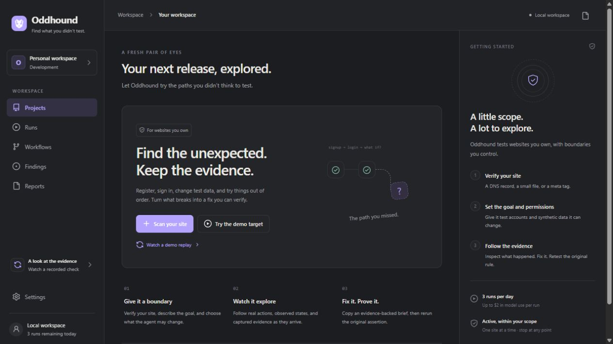

# Oddhound — Find what you didn’t test

Active exploratory testing for websites you own. Verify a site, authorize test accounts and synthetic writes, then inspect the evidence from unexpected actions and replay the original assertion after a fix.

**Work in progress.** This repository contains the independent ChatGPT implementation. It is not a deployed scanner or a completed security certification. Public website execution is disabled.



## Implemented so far

- macOS-inspired workspace, project setup, ownership instructions, run history, evidence inspector, workflow view and report export.
- PostgreSQL persistence, GitHub authentication integration, explicit local-development identity, and encrypted credential references.
- Direct Meta adapter and bounded tool loop, durable PostgreSQL BullMQ queue/outbox, action intents, generation fences, conservative spend reservations and cancellation handling.
- Fly fresh-Machine controller and independent reaper code. The browser image passes 15 local scripted tool checks; its deployed isolation proof is still pending.
- An owned synthetic booking application with real registration, login, create/edit/cancel and a corrected control mode.

Private screenshot delivery and the actual browser tool path are implemented. Typed owner grants now freeze selected accounts, independently verified API scopes and write boundaries; [contract evidence and limits](docs/RUN_AUTHORIZATION.md) include 11 real mapped-policy canary checks and four Python policy checks. Autonomous signup/login and exploratory writes now pass on the owned fixture and a corrected comparison. Generic independent finding verification and live fixed-assertion retests are not complete.

## Evidence

The current recorded results are **27 passing focused tests**, **5 passing PostgreSQL integration tests**, TypeScript validation and a successful production build. Scripted HTTP plus independent SQL checks exercise both fixture modes. Fifteen actual browser-tool checks also pass on an owned HTTPS fixture, including non-root sandbox startup, signup/login, synthetic writes, actor isolation and closure. These are component results, not a full release verdict. See [browser runtime evidence](docs/BROWSER_RUNTIME.md).

Direct Meta authentication and two actual `muse-spark-1.3` tool calls passed on October 27, 2026. Accounted usage was **$0.004119** under a $0.10 reservation. The tool observation was synthetic; no website was scanned. See [provider evidence](docs/PROVIDER_SMOKE_TESTS.md).

Two real Meta-driven browser runs completed on the owned fixture and its corrected comparison. Together with the preserved stopped attempt, development model use was $2.216998. See [autonomous exploration evidence](docs/AUTONOMOUS_EXPLORATION.md).

The labelled engineering replay is a scripted browser check on an owned fixture. It is never presented as live or autonomous inference.

## Run locally

Docker is required. The image pins Node 26; the host Node installation is not changed.

```sh
docker compose run --rm setup
docker compose run --rm setup pnpm exec tsx apps/fixture/bootstrap.ts
docker compose up -d web worker reaper fixture fixture-corrected
```

Open the workspace at **http://127.0.0.1:3000/**. The fixture is at http://localhost:3002/ and the corrected control at http://localhost:3003/. All published development ports bind to loopback. The status page is `/status`.

Copy `.env.example` to `.env.local` and configure only the services you own. `.env.local` is ignored. Never commit API keys, target credentials, cookies or private traces. GitHub CLI access to this repository does not configure the product's GitHub OAuth application.

```sh
docker compose run --rm setup pnpm typecheck
docker compose run --rm setup pnpm test
docker compose run --rm setup pnpm build
docker compose run --rm setup pnpm audit:deps
```

Integration tests deliberately require a separate database whose name ends in `_test`; see [verification instructions](docs/IMPLEMENTATION.md). Paid provider smoke commands are explicit and are not run by unit tests or CI.

## Build direction

Active testing remains the core: discovery, registration/login, synthetic writes, boundary inputs, repeated actions and unusual ordering. Ownership, origin/account/data boundaries, fresh browser isolation, quotas and immutable assertions stay outside model control. See [product requirements](docs/SPECIFICATION.md), [implementation status](docs/IMPLEMENTATION.md) and [versions](docs/VERSIONS.md).
