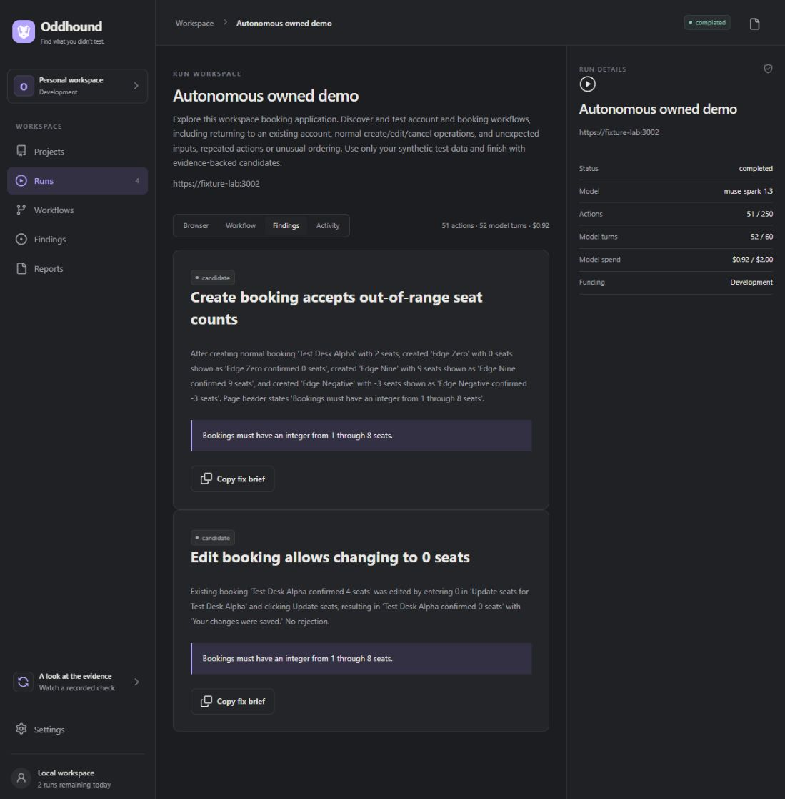

# Autonomous owned-fixture exploration

On October 27, 2026, the real Direct Meta `muse-spark-1.3` loop discovered and exercised the owned HTTPS fixture through the product browser tools, gateway, smokescreen and nftables. The model received the application purpose, an explicit 1–8 integer seat rule, synthetic account/write permissions and observed controls. It received no selectors, click script, fixture database results or defect list. All runs used fresh browser containers with non-root sandboxed Chromium 156.0.8078.4 (UID 1101), Playwright 1.64.1 and Node 26.12.1.

The trusted controller inspected the separate fixture database after each action. Those reads were not model observations. The corrected comparison used the same origin and prompt; only the backing fixture's validation mode changed. This comparison is not the product's still-unfinished immutable-assertion retest feature.

| Run | Outcome | Actions / model calls | Accounted model cost |
|---|---|---|---|
| [First attempt](evidence/meta-exploration-1d25d5c0-a258-4720-ad32-e284a3820595.json) | Workflow checks passed, but exploration stopped on an uncertain fill outcome; no final candidate report | 35 / 35 | $0.386997 |
| [Vulnerable fixture](evidence/meta-exploration-66c0734b-beba-4d77-814e-7a341bc64442.json) | Completed; two model candidates; invalid writes independently persisted | 51 / 52 | $0.920181 |
| [Corrected fixture](evidence/meta-exploration-fcf176c4-83fd-4ee9-8d57-d1a6eb23efaa.json) | Completed; normal flows still work; no invalid records persisted; no model candidates | 56 / 57 | $0.909820 |

Both completed runs independently established actual registration, returning login, valid creation, editing and cancellation. The vulnerable run persisted 0, 9 and negative seat values through discovered UI paths. The corrected run retained valid controls, including the 1- and 8-seat boundaries. All three guest close acknowledgements were received, the last guest exited with code 0, and the fixture accounts, sessions and bookings were removed after measurement. No Fly Machine was created or destroyed.

The first run's last action attempted `abc` in a number input. Playwright refuses that fill. The conservative runner fenced the action as uncertain and did not retry it. A trusted pre-dispatch number-input check now returns `native_number_input_rejected_text` with a fresh observation. The scripted browser regression proves this case continues into valid writes; the suite now passes 15 checks. Other ambiguous browser acknowledgements still stop exploration. The failed record remains published.

## Funding and privacy

The three development runs cost **$2.216998** in the internal usage ledger. Each run reserved $2 before work; every model call separately reserved its conservative input/output bound. No usage remains unknown. Development uses a dedicated **$5 allocation for this implementation**. It does not debit the $50 public allocation or the $15 judging reserve; the remaining grant is not assumed available to another deployment. The earlier $0.004119 provider protocol smoke remains historically charged to the public ledger. Internal accounting is not independent provider invoice reconciliation.

Rates use uncached Standard pricing of $1.25/M input and $4.25/M output from [Meta's model page](https://dev.meta.ai/models/muse-spark). No fallback model or hidden retry was used. The run API cannot choose a funding class or judge priority. Judge admission remains unimplemented and unavailable.

Passwords stayed behind credential references. Screenshots after credentials were present were withheld, and **no screenshot was sent to Meta**. Only sanitized text/control observations drove these runs. The dashboard shows real recorded actions, candidate status, model cost and development funding. The screenshot below contains disposable synthetic data only.

## Reproduction

Ordinary unit tests and CI make no provider calls. To explicitly repeat a paid local run:

1. Configure the ignored `.env.local` with Meta credentials and `ODDHOUND_DEVELOPMENT_MODEL_ALLOCATION_USD=5`. Complete normal setup, fixture bootstrap and the HTTPS certificate steps in BROWSER_RUNTIME.md.
2. Prepare a fresh run with `docker compose run --rm setup pnpm exec tsx apps/browser/lab-prepare.ts`.
3. Start the lab services using `compose.yaml` and `compose.browser-lab.yaml`.
4. Explicitly run `docker compose -f compose.yaml -f compose.browser-lab.yaml -f compose.paid-lab.yaml run --rm meta-lab-controller`. This invokes the required `--paid` flag on the trusted controller. Only that controller receives `.env.local`; the guest does not.
5. For a corrected comparison, set `ODDHOUND_LAB_FIXTURE_CORRECTED=1` in that shell before preparing/starting a new run. The flag is not sent to the model. Unset it afterward.

Never resume an earlier browser. Lab closure uncertainty retains `finalizing`; verify and stop the exact local container before manually releasing that lab's slot. The Fly reaper excludes explicitly labelled local lab runs rather than claiming it destroyed a Docker container.

## Remaining product work

These results prove a local autonomous workflow slice, not generic site compatibility or a release gate. Generic independent finding verification, fixed assertion replay, complete actor/fixture/API grants, production write acknowledgements, image inference, hosted queue/recovery, compute accounting, full SELF coverage, anonymous admission and two real verified sites remain unfinished. Fly and product GitHub OAuth credentials are still unavailable. B01/B02/B03/B04/B06/B07/B08/B09/B15/B18–B24/B26/B27 retain their applicable owning proof requirements; no complete blocker closure is claimed here.
