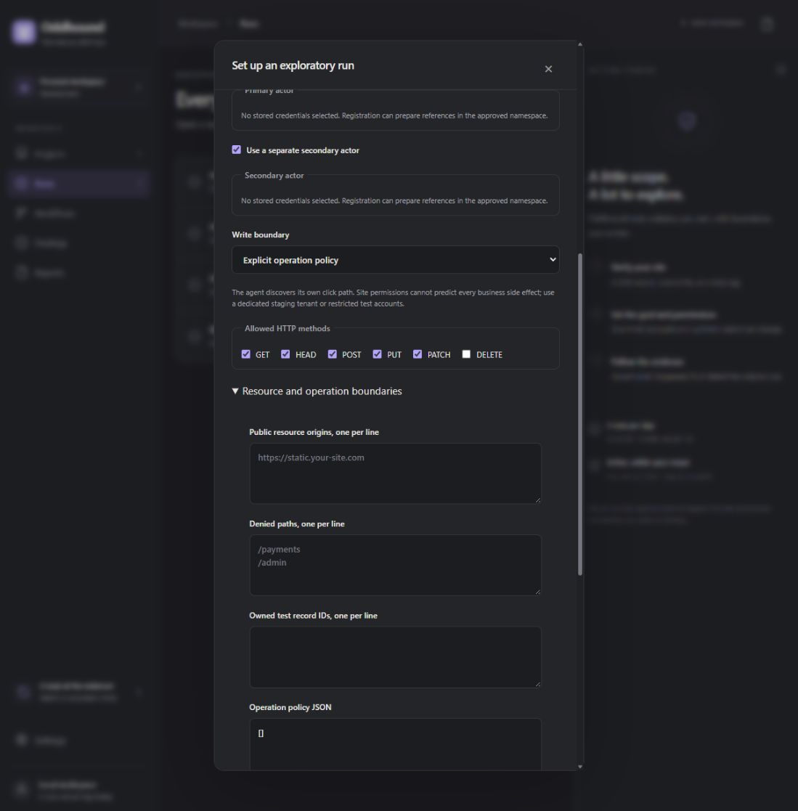

# Owner authorization contract

Runs now save a typed, immutable version of the owner's authorization. The setup selects the primary UI site, separately verified API sites, HTTP methods, actor/credential bindings, registration namespace, owned fixture IDs, resource origins, denied paths and cleanup instructions. Production writes require an explicit acknowledgement and a mapped operation policy. Raw passwords never belong in this form.

The server records site revisions and the exact selected credential IDs/revisions, then hashes a canonical snapshot. PostgreSQL refuses changes to a run's scope, goal, owner or site after insertion. The worker checks the snapshot and credential revisions after queue wait, independently re-verifies every active UI/API origin, and decrypts only the selected credentials. Unselected administrator or unrelated references are not delivered to the browser. Resource origins carry no API or UI-navigation authority.

Credential rotation/removal and ownership revocation fence affected runs by generation. Queued runs are blocked and release their reservations; their public quota is refunded because provisioning never began. Active runs enter stopping. The full accepted-stop/dispatch race and deployed closure grace still need their existing SELF proof; these SQL tests do not claim that a committed target write can be undone.

Each API has its own method selection; it does not inherit UI write methods. Changing the primary project clears selected actors, API scopes, operation/fixture fields and acknowledgements.

## Browser enforcement

The guest rejects undeclared actors and credentials, caps prepared identities at the owner's limit, and requires references for recognized username/email/password fields. Visible identity-marker observations are recorded as booleans. A marker means the expected visible text was found; it is not cryptographic proof of authentication or privilege.

Isolated staging permits discovery of new paths and ordinary approved write methods. It depends on the owner's dedicated synthetic tenant, least-privilege accounts and disabled external effects. A generic HTTP browser cannot infer every business effect from a method or button label. This mode is not a universal semantic authorization boundary.

Mapped policy checks each non-GET/HEAD application write against an approved origin, method, path and effect. `:fixture` only matches explicitly granted record IDs. Form/JSON fields may be bound to a synthetic namespace prefix or a granted fixture ID. Duplicate body fields, wrong encodings, foreign namespaces and ungranted IDs are refused. Requests are buffered within the existing 8 MiB cap before body authorization; automatic request streaming was removed. TLS upstream verification, response streaming limits, smokescreen and UID firewall isolation remain enabled.

For example, these are permission mappings rather than a browser click script:

```json
[
  {"scope":"ui","method":"POST","path":"/register","effect":"register","body":{"encoding":"form","field":"username","match":"namespace_prefix"}},
  {"scope":"ui","method":"POST","path":"/records","effect":"create","body":{"encoding":"json","field":"record.name","match":"namespace_prefix"}},
  {"scope":"ui","method":"POST","path":"/records/:fixture/cancel","effect":"cancel"}
]
```

API operations use the independently selected API project's ID as `scope`. The UI/API methods must include each operation's method. Mapped production create/edit/cancel operations need a record-ID or body binding. These sample paths are examples only; the owner must configure their application's real operations.

Known mapped registration operations reserve a request slot before forwarding. Uncertain or failed responses do not silently free it, so this is a conservative request-attempt bound. Email identifiers are restricted to the declared test mailbox domain. Generated passwords remain credential references. Unknown signup semantics under broad staging are not fully classified: complete successful-account caps across unexpected paths remain part of B06/B19/SELF-17. Missing mailbox verification or SSO support still blocks the workflow.

Static record IDs are supported. Capturing and binding newly created IDs across arbitrary applications is unfinished; a mapped production workflow can be blocked when it needs an unbound ID. Per-context credentials are bound, but stronger application-specific identity/fixture proofs and the remaining worker/frame/socket/resource/deployed matrix are still required. No complete SELF or public-launch clearance follows from this slice.

The initial form-encoded API canary did not exercise CORS preflight. Strengthening it to a JSON request [reproduced a legitimate-flow failure](evidence/owner-grants-a7838f81-db3e-4196-a583-d6cd6e4fa0a3.json). The gateway now permits a preflight only from the verified UI to a selected API, for an already-granted method and mapped operation. The actual write still passes the complete body policy. The [passing JSON canary](evidence/owner-grants-bca50de7-ad40-49df-ad51-eab3ee51a508.json) records two allowed preflights plus four allowed writes, with prohibited write/preflight nonces absent. CORS does not expand origin authority.

## Actual verification

- 27 focused TypeScript tests passed. Model replies, verification rows and credential metadata in these tests are injected synthetic data; no real DNS verification or provider call is implied.
- Five real PostgreSQL tests passed, including scope immutability, selected-credential rotation, queued reservation/quota refund and independently scoped API revocation.
- Four Python request-policy tests passed inside the product browser image without network access.
- The existing 15 real scripted browser checks still pass with typed guest grants, including signup, login, identity-marker observation, permitted create/edit/cancel, boundary writes, actor separation, credential capture suppression and closure.
- Eleven mapped-policy canary checks passed. The separate fixture database recorded exactly four permitted writes and two expected CORS preflights: primary create, owned-record cancel, first registration request and the declared API create. No foreign namespace, foreign fixture, unmapped operation, second registration or unapproved API request nonce arrived. This proves the tested request subset, not every application business effect.

The current [canary evidence](evidence/owner-grants-latest.json) and [browser evidence](evidence/browser-tools-lab.json) retain exact run IDs, arrivals and sandbox verdicts. Chromium 156.0.8078.4 runs as UID 1101 with namespace and Seccomp-BPF sandboxing; Playwright is 1.64.1 and Node is 26.12.1. Guest exit code 0 was confirmed locally. No Fly deployment occurred and this slice made no Meta calls. Previous real Meta exploration remains separately documented in AUTONOMOUS_EXPLORATION.md.

The setup UI was checked on an explicitly unverified local project. Actor and operation controls work; starting its run remains disabled. That UI test did not verify or scan a public site. The historical autonomous runs are not retroactively given new approval snapshots.



To repeat the request canaries after normal local fixture/bootstrap/certificate setup, build the browser image, run `apps/browser/lab-prepare.ts --grants` with the pinned setup service, recreate the lab services, then run the `browser-lab-controller` with `pnpm exec tsx apps/worker/lab-grants.ts`. Prepare a fresh run/browser for the ordinary `lab-check.ts` workflow separately. The CI workflow runs both and never loads Meta credentials into either test.

A synthetic quoted-credential regression initially failed because redaction compared values after JSON escaping. The runner now sanitizes individual strings before encoding permissions and observations; the regression passes. No provider call or actual credential was involved. The sanitized [regression record](evidence/quoted-secret-regression.json) retains the failed-before/passed-after distinction.

The worker’s guest-scope serializer also normalizes PostgreSQL expiry `Date` values to ISO strings and strips controller-only fields. Its focused test passes; actual Fly creation remains untested.

## Next product work

Independent finding assertions and unchanged retests remain next. Dynamic fixture bindings, full registration/actor enforcement, compute/recovery/retention, anonymous admission, hosted integration and all applicable SELF gates remain incomplete. Fly and product GitHub OAuth credentials are still unavailable. B03/B04/B06/B07/B08/B09/B15/B18–B24/B26/B27 retain their owning proof requirements. Public execution stays closed.
